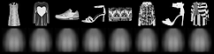
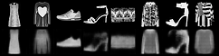

# Posterior Collapse

For this project a VAE model was trained on FashionMNIST dataset. The loss consists of a per-pixel MSE reconstruction term and a KL divergence term that regularises the encoder's Gaussian distribution towards the prior, `N(0, I)`.

The MSE is averaged over the 784 pixels, whereas the KL divergence is summed over the latent dimensions:

```text
KL = -0.5 * sum_j (1 + log σ²_j - μ²_j - σ²_j)
```

At initialisation, the two terms are approximately 9.2 and 0.23, respectively. I trained the model twice, using the following objectives:

```text
MSE + β * KL
MSE + β * KL / (H * W)
```

`β` is shared by both runs. It goes up every two epochs and is capped at 0.5:

| Epochs | β |
|---|---|
| 1–2 | 0.2 |
| 3–4 | 0.4 |
| 5–10 | 0.5 |

The KL numbers below are that term on its own, before multiplication by `β`.

## No normalisation

The KL starts near 9.2. With β at 0.2 that is a penalty of about 1.8, far above the MSE of 0.23, so the KL is heavily penalised from the start. It is already 0.37 after 100 steps, about 0.05 at the end of the first epoch, and near zero from epoch 3. Validation MSE stays at 0.088, and the reconstructions are the same grey image.

## Per-pixel normalisation

The KL is divided by 784. It starts at 0.012, rises to about 0.05 in the first few hundred steps, and settles near 0.018 once β is 0.5. Validation MSE falls to 0.012 by epoch 2 and finishes at 0.016. The clothing items stay identifiable.

## Training

| MSE | KL | Loss |
|---|---|---|
|  |  |  |

## Validation

| MSE | KL | Loss |
|---|---|---|
|  |  |  |

## Latent mean and standard deviation

| Mean | Standard deviation |
|---|---|
|  |  |

With no normalisation, the posterior collapses onto `N(0, I)` almost immediately. After about 100 steps, the mean is already within 0.01 of 0 and the standard deviation is 1. Both lines stay flat for the rest of training.

With per-pixel normalisation, the same process is slower. The mean continues to fluctuate around 0, while the standard deviation increases steadily from approximately 0.6 towards 0.87. This suggests that the encoder is retaining more variation in the latent representation rather than immediately matching the prior.

## Reconstructions after the final epoch

Each column shows a comparison between an original image and its corresponding reconstruction.

| No normalisation | Per-pixel normalisation |
|---|---|
|  |  |